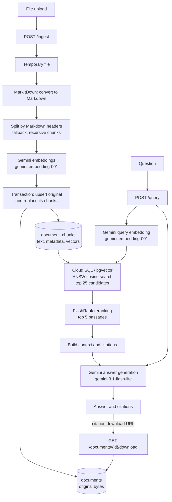

# RAG+GCP

## Run locally with Docker Compose

Requires Docker with the Compose plugin and a Gemini API key.

From the repository root, create a `.env` file with your API key (this file is
git-ignored):

```sh
echo 'GEMINI_API_KEY="your-gemini-api-key"' > .env
bash local.sh
```

`local.sh` loads `.env` and builds and starts the services in the background.

- Frontend: http://localhost:3000
- Backend API: http://localhost:8080 (docs at `/docs`, health at `/health`)
- PostgreSQL with pgvector runs on the internal Compose network. Data persists
  in the `postgres_data` volume, and the backend initializes the schema on startup.
  Embeddings are stored as 3,072-dimensional vectors. Retrieval uses a
  half-precision HNSW expression index (requires pgvector 0.7.0 or newer),
  since regular vector HNSW indexes support at most 2,000 dimensions.

The frontend image builds with `http://localhost:8080` as its browser-facing API
URL. The backend waits for PostgreSQL, and the frontend waits for the backend
health check. The first build downloads dependencies and the FlashRank model.
Document ingestion and queries use Gemini and require internet access.
The database credentials in Compose are for local development only.

The workspace container stays running with an interactive Bash shell. Open a
shell in it with:

```sh
docker compose exec workspace bash
```

## Backend ingestion and retrieval



### Download original documents

New uploads retain their original bytes in PostgreSQL, in the same transaction
as their indexed chunks. Each answer citation includes a **Download original
document** link, served by `GET /documents/{document_id}/download`.
Re-uploading the same filename replaces both the original and its indexed chunks.
Originals persist with the database, including across container restarts.

Documents indexed before this feature must be re-uploaded to enable downloads.
As with ingestion and querying, downloads currently have no authentication; keep
the app restricted to trusted users.

```sh
docker compose logs -f
docker compose down
```

Stopping the stack preserves database data. To also delete the local database:

```sh
docker compose down -v
```

## Deploy the backend to Cloud Run

The [backend deployment workflow](./.github/workflows/deploy-backend.yml) deploys
on pushes to `main` that change `backend/` or the workflow, and can also be run
manually. Run `workspace/setup.sh` first to configure the Google Cloud
APIs, Workload Identity Federation, and service accounts.

Configure these GitHub Actions repository secrets:

- `GCP_PROJECT_ID`
- `GCP_WORKLOAD_IDENTITY_PROVIDER` (the full provider resource name printed by
  the setup script)
- `GEMINI_API_KEY`
- `DB_USER`
- `DB_PASS`

Also set the required repository variable `CLOUD_SQL_INSTANCE_CONNECTION_NAME`
to the Cloud SQL instance connection name (`project:region:instance`). The
workflow defaults `DB_NAME` to `ragdb`. Set the required
`BACKEND_RUNTIME_SERVICE_ACCOUNT` repository variable to the backend service
account email created by the setup script. This account is used both to
authenticate the workflow through Workload Identity Federation and as the
Cloud Run runtime identity. The Cloud SQL instance must contain the database
configured by `DB_NAME` and support pgvector.

The backend is deployed with unauthenticated access so the browser frontend can
call it. The API has no application authentication, so its upload, query, and
download endpoints are public; do not use this deployment for untrusted traffic
or sensitive documents.

## Deploy the frontend to Cloud Run

The [frontend deployment workflow](./.github/workflows/deploy-frontend.yml) uses
the same `GCP_PROJECT_ID` and `GCP_WORKLOAD_IDENTITY_PROVIDER` repository
secrets as the backend workflow.
Configure these additional repository variables:

- `VITE_API_URL`: the backend's public HTTPS origin, without a path. This is
  embedded during the Docker build; changing it requires redeployment.
- `ARTIFACT_REGISTRY_REPOSITORY`: the name of an existing Docker repository in
  the `CLOUD_RUN_REGION` region (defaults to `us-central1`). The deployer needs
  Artifact Registry Writer access, as granted by the setup script.
- `FRONTEND_RUNTIME_SERVICE_ACCOUNT`: an existing, dedicated runtime service
  account email created by the setup script. It is used both to authenticate
  the workflow through Workload Identity Federation and as the Cloud Run
  runtime identity.
- Optional `FRONTEND_CLOUD_RUN_SERVICE`: defaults to `rag-gcp-frontend`. This is
  separate from the backend's `CLOUD_RUN_SERVICE` variable to avoid overwriting
  the backend service.

The workflow builds and pushes a commit-tagged image, deploys it to Cloud Run
on port 8080 with public access, and checks the deployed root URL. It does not
pass Gemini credentials to the frontend.

## Frontend development

The frontend uses React, TypeScript, and Vite. With Node.js 20.19+ and npm:

```sh
cd frontend
npm ci
npm run dev
```

The development server runs at http://localhost:3000 and connects to the backend
at http://localhost:8080 by default. Set `VITE_API_URL` to use another backend.
This variable is embedded at build time for production.

```sh
npm run typecheck
npm run build
```

The production build type-checks both the React application and Vite configuration
before bundling. Docker uses the same build command.

The app layout lives in `frontend/src/App.tsx`. Feature components are in
`frontend/src/components/`: `DocumentIngestion` handles uploads, `QueryPanel`
handles questions, and `AnswerCard` and `CitationCard` display answers and sources.
Shared API requests and response types live in `frontend/src/api.ts`.

### Frontend languages

The UI supports English and Spanish using i18next and react-i18next. It first
checks the saved language preference, then the browser's preferred languages,
and falls back to English. Regional variants such as `es-AR` use their base
language. The header language selector saves the choice in local storage under
`rag-language`. The page's language metadata is updated with the selection.

Translations live in `frontend/src/locales/en.json` and `es.json`; keep their
keys aligned. Translation keys are type-checked against the English dictionary.
To add another language, add its dictionary and register it in
`frontend/src/i18n.ts` and `LanguageSwitcher`. Also extend the query-language
mapping in `frontend/src/api.ts` and the backend's `QueryRequest` schema and
answer-language instructions.

Queries send the active UI language as `language: "en"` or `language: "es"` to
`POST /query`. The backend requests a generated answer in that language, regardless
of the question or document language. Its empty-database response is also
localized. Clients that omit `language` default to English; unsupported language
codes return HTTP 422. Changing the UI language affects subsequent queries, not
answers already displayed.

Uploaded documents, filenames, retrieved source content, and backend error
details are left unchanged.

## Backend formatting

The backend has its own Prettier configuration for supported files such as JSON,
YAML, and Markdown. Python files are explicitly excluded; Prettier does not
format Python. These commands require Node.js and npm:

```sh
cd backend
npx prettier@3 --write . --ignore-unknown
npx prettier@3 --check . --ignore-unknown
```

In VS Code, the Prettier extension discovers the backend configuration
automatically. Do not select Prettier as the formatter for Python files.
